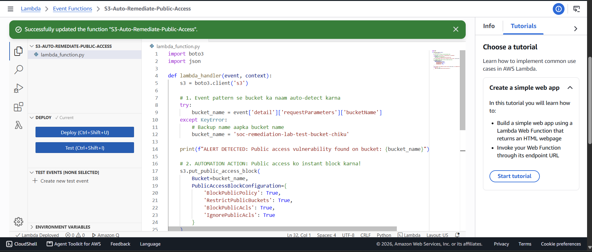
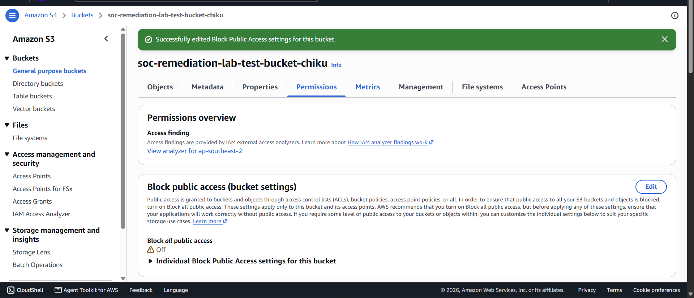
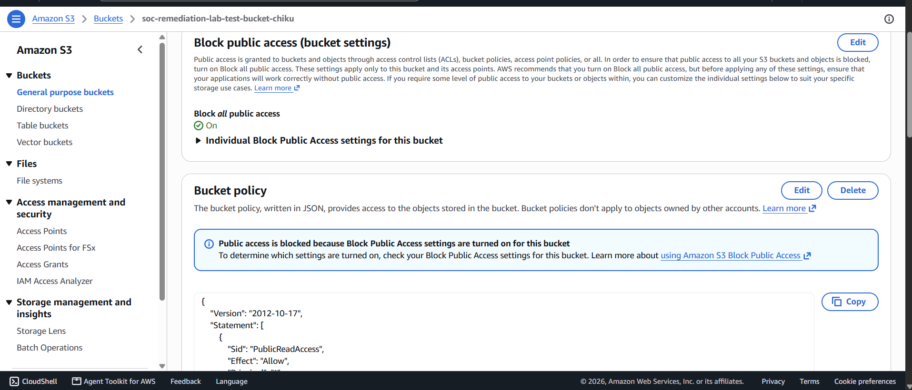

# AWS S3 Public Access Detection & Automated Containment (SOAR Lab)

## 📌 Project Overview
Misconfigured Amazon S3 buckets are a common cloud security risk that can expose sensitive data to the public internet. In this lab, I built an automated cloud security detection and containment workflow using **AWS CloudTrail**, **Amazon EventBridge**, and **AWS Lambda (Python / Boto3)**.

When public access protections are disabled on an S3 bucket, EventBridge captures the CloudTrail management event and invokes a Lambda function to automatically restore **Block Public Access** settings, reducing manual response delays while preserving audit logs for **SOC L1 investigation**.

---

## 🛠️ Architecture & Detection Flow
1. **Simulated Threat / Misconfiguration:** S3 *Block all public access* is disabled (`Off`) and a `PublicReadAccess` bucket policy is attached (mapped to **MITRE ATT&CK T1530: Data from Cloud Storage**).
2. **Audit Logging (AWS CloudTrail):** CloudTrail records the S3 API activity (`PutPublicAccessBlock`, `DeleteBucketPublicAccessBlock`, `PutBucketPolicy`, `PutBucketAcl`) with actor identity, source IP, and timestamp.
3. **Real-Time Event Matching (Amazon EventBridge):** An EventBridge rule monitors S3 management events via CloudTrail and triggers the Lambda response function when public access modifications occur.
4. **Automated Containment (AWS Lambda):** A Python (`boto3`) script extracts the target bucket name from the event payload and programmatically enforces all four S3 Public Access Block flags.

---

## 🧪 Proof of Execution

### 1. Lambda Auto-Remediation Function
Configured an AWS Lambda function (`S3-Auto-Remediation-Public-Access`) using Python and `boto3` to parse incoming CloudTrail event details and enforce `put_public_access_block()` on the affected bucket.

### 2. Simulated Cloud Exposure (Alert Trigger)
To test detection, **Block all public access** was turned **Off** on a test S3 bucket, creating an exposed state (`Off` warning indicator) and generating a CloudTrail management event.

### 3. Automated Containment Verification
Following EventBridge rule invocation, the Lambda script automatically re-enabled **Block all public access** (`On`). As shown below, S3 confirms that public access via the attached `PublicReadAccess` bucket policy is now blocked.

---

## 🔍 SOC L1 Triage & Investigation Workflow
In a real SOC environment, automated containment is only the first step. As an L1 analyst reviewing this alert, the investigation workflow includes:
* **Alert Validation:** Verify in CloudWatch Logs and CloudTrail that `PutPublicAccessBlock` succeeded and the bucket is isolated.
* **Actor & Source Attribution:** Inspect `userIdentity.arn`, `sourceIPAddress`, and `userAgent` in the CloudTrail JSON log to determine who disabled the control and from which IP address.
* **Policy Hygiene Check:** Confirm whether an overly permissive bucket policy (such as `PublicReadAccess`) remains attached and coordinate its removal with the cloud owner.
* **Escalation Criteria:** Escalate to Tier 2 / Incident Response if the source IP is unrecognized, originates from an unusual ASN/geolocation, or if multiple IAM/S3 changes occur in rapid succession.

---

## 📁 Repository Contents
* `lambda_function.py` – Python `boto3` remediation handler with CloudWatch forensic logging.
* `eventbridge_rule.json` – EventBridge event pattern monitoring S3 public access API calls.
* `sample_incident_report.md` – Standardized SOC L1 triage and escalation report for this simulated incident.
